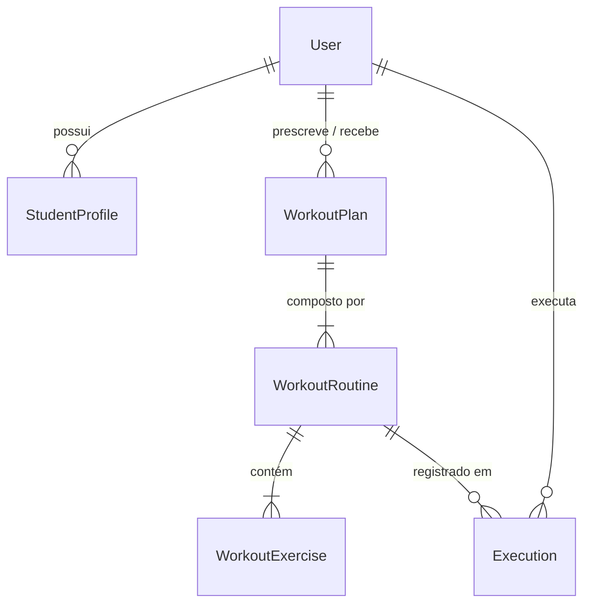

# GymFlow API — Gestão de Treinos e Acompanhamento Físico

[](https://github.com)
[](https://www.python.org/)
[](https://fastapi.tiangolo.com/)
[](https://www.sqlalchemy.org/)
[](https://swagger.io/)
[](https://datatracker.ietf.org/doc/html/rfc9457)
[](https://docs.pytest.org/)

> **Projeto Semestral de Arquitetura de Software & Desenvolvimento de APIs REST**  
> **Metodologia:** Spec-Driven Development (SDD) com Agentes de IA  
> **Homologação:** 100% de Aprovação nos Testes Automatizados (Pytest)  

---

## 📌 Sumário Executivo para Avaliação (Critérios da Disciplina)

| # | Critério de Avaliação | Onde Encontrar no Repositório | Status |
| :-: | :--- | :--- | :---: |
| **1** | **Organização da Equipe** | [Seção 1: Equipe Envolvida](#1-organização-da-equipe) e papéis definidos | ✅ Concluído |
| **2** | **Desenvolvimento com IA usando SDD** | [SPEC.md](file:///c:/Users/eeral/.gemini/antigravity/scratch/gymflow-api/SPEC.md), [PLAN.md](file:///c:/Users/eeral/.gemini/antigravity/scratch/gymflow-api/PLAN.md), [AGENTS.md](file:///c:/Users/eeral/.gemini/antigravity/scratch/gymflow-api/AGENTS.md) e [STYLEGUIDE.md](file:///c:/Users/eeral/.gemini/antigravity/scratch/gymflow-api/STYLEGUIDE.md) | ✅ Concluído |
| **3** | **Arquivos de Especificação** | [gymflow_apidog.json](file:///c:/Users/eeral/.gemini/antigravity/scratch/gymflow-api/gymflow_apidog.json), Swagger (`/docs`) e ReDoc (`/redoc`) | ✅ Concluído |
| **4** | **Autenticação & RBAC** | `src/api/security.py`, `src/api/dependencies.py` e rotas em `src/api/routers/auth.py` | ✅ Concluído |
| **5** | **ORM (Object-Relational Mapping)** | `src/api/models.py` (SQLAlchemy 2.0 Declarativo) e `src/api/database.py` | ✅ Concluído |
| **6** | **Testes Automatizados** | 32 testes em `src/api/tests/` (100% passando com `pytest -v`) | ✅ Concluído |
| **7** | **Conteúdos Extras** | Dockerfile, Docker Compose, GitHub Actions CI, `api.http` e Cloud Mock | ✅ Concluído |
| **8** | **Demonstração Funcional** | [Seção 8: Roteiro de Demonstração ao Vivo](#8-roteiro-de-demonstração-funcional-ao-vivo) | ✅ Concluído |

---

## 1. Organização da Equipe

| Integrante | RA / Matrícula | E-mail Institucional | Função Principal no Projeto |
| :--- | :--- | :--- | :--- |
| **[Nome Integrante 1]** | `[RA 1]` | `email1@instituicao.edu.br` | **Tech Lead** (Arquitetura, SDD e Modelagem ORM) |
| **[Nome Integrante 2]** | `[RA 2]` | `email2@instituicao.edu.br` | **Backend Coder** (Autenticação JWT, Rotinas e Schemas) |
| **[Nome Integrante 3]** | `[RA 3]` | `email3@instituicao.edu.br` | **QA Engineer** (Suíte Pytest, Fixtures e Validação RFC 9457) |
| **[Nome Integrante 4]** | `[RA 4]` | `email4@instituicao.edu.br` | **DevOps & Specs** (OpenAPI, Apidog Mock e CI/CD) |

---

## 2. Desenvolvimento com IA usando SDD (Spec-Driven Development)

O projeto adotou a metodologia **Spec-Driven Development (SDD)**, orientada a especificações antes da codificação:

```text
┌─────────────────┐      ┌─────────────────┐      ┌─────────────────┐      ┌─────────────────┐
│     SPEC.md     │ ───► │     PLAN.md     │ ───► │  Código + ORM   │ ───► │ 32 Testes Pytest│
│ Contrato OpenAPI│      │ 7 Fases do Líder│      │ Implementação   │      │ 100% Aprovados  │
└─────────────────┘      └─────────────────┘      └─────────────────┘      └─────────────────┘
```

1. **[SPEC.md](file:///c:/Users/eeral/.gemini/antigravity/scratch/gymflow-api/SPEC.md)**: Requisitos Funcionais (RF01-RF08), Não Funcionais (RNF01-RNF05) e Contratos.
2. **[PLAN.md](file:///c:/Users/eeral/.gemini/antigravity/scratch/gymflow-api/PLAN.md)**: Plano granular em 7 fases elaborado pela persona `[Tech Lead]` e homologado por `[QA Engineer]`.
3. **[AGENTS.md](file:///c:/Users/eeral/.gemini/antigravity/scratch/gymflow-api/AGENTS.md)**: Governança das personas de IA (`[Tech Lead]`, `[Backend Coder]`, `[QA Engineer]`) e Registro de Decisões de Arquitetura (ADRs).
4. **[STYLEGUIDE.md](file:///c:/Users/eeral/.gemini/antigravity/scratch/gymflow-api/STYLEGUIDE.md)**: Convenções de código PEP 8, Pydantic v2 e RFC 9457.

---

## 3. Arquivos de Especificação & Design-First

- **Contrato OpenAPI 3.1.0 Completo:** [gymflow_apidog.json](file:///c:/Users/eeral/.gemini/antigravity/scratch/gymflow-api/gymflow_apidog.json)
  - 12 rotas modeladas e 26 schemas desacoplados (zero objetos inline).
  - Regras dinâmicas de Faker.js / Mock.js (`@guid`, `@name`, `@email`, `@datetime`, `@float`).
- **Documentação Swagger Interativa:** `http://127.0.0.1:8000/docs`
- **Documentação ReDoc:** `http://127.0.0.1:8000/redoc`

---

## 4. Autenticação & Segurança (RBAC)

- **Criptografia de Senhas:** Hash seguro com `bcrypt` e salt dinâmico via `passlib`.
- **Tokens JWT Stateless:** Algoritmo `HS256`, claim `sub`, papel de usuário `role` e expiração de 24h.
- **Role-Based Access Control (RBAC):**
  - Injeção de dependências via `FastAPI Depends`: `get_current_user`, `require_personal`, `require_student`.
  - Rotas exclusivas de Personal (`require_personal`): Cadastro de alunos, montagem de treinos, prescrição de exercícios.
  - Rotas exclusivas de Aluno (`require_student`): Registro de execução e feedback RPE.
  - Segregação de carteira: Alunos só acessam seus próprios treinos; Personals só acessam seus alunos.

---

## 5. Camada de Persistência & ORM (SQLAlchemy 2.0)

Mapeamento relacional declarativo moderno em `src/api/models.py`:



- **Modelos Mapeados:**
  - `User`: Personal Trainers e Alunos com vínculo relacional.
  - `StudentProfile`: Dados biométricos, metas e observações.
  - `WorkoutPlan`: Fichas periodizadas com status e vigência.
  - `WorkoutRoutine`: Divisões de treino (A, B, C...) com ordenação.
  - `WorkoutExercise`: Exercícios técnicos com grupamentos musculares, séries e carga.
  - `Execution`: Sessões realizadas com duração, pontuação RPE (1-10) e feedback.
- **Recursos Avançados de ORM:**
  - Tipagem moderna via `Mapped[...]` e `mapped_column(...)`.
  - Integridade referencial com Foreign Keys e `cascade="all, delete-orphan"`.
  - Carregamento otimizado de relacionamentos via `selectinload`.

---

## 6. Testes Automatizados (32 Testes 100% Aprovados)

A suíte em `src/api/tests/` garante isolamento e idempotência total por meio de fixtures determinísticas em `conftest.py`:

```bash
pytest -v
```

**Resultado da Execução:**
```text
src/api/tests/test_auth.py (8 testes) ................ PASSED
src/api/tests/test_students.py (8 testes) ............ PASSED
src/api/tests/test_workouts.py (8 testes) ............ PASSED
src/api/tests/test_executions.py (4 testes) .......... PASSED
src/api/tests/test_errors.py (4 testes) .............. PASSED
======================== 32 passed in 2.49s ========================
```

---

## 7. Conteúdos Extras (Diferenciais do Projeto)

1. **Containerização Docker:**
   - [Dockerfile](file:///c:/Users/eeral/.gemini/antigravity/scratch/gymflow-api/Dockerfile) multi-stage otimizado.
   - [docker-compose.yml](file:///c:/Users/eeral/.gemini/antigravity/scratch/gymflow-api/docker-compose.yml) para inicialização em 1 comando.
2. **Integração Contínua (CI):**
   - Workflow do GitHub Actions em [.github/workflows/ci.yml](file:///c:/Users/eeral/.gemini/antigravity/scratch/gymflow-api/.github/workflows/ci.yml) rodando os testes a cada push.
3. **Arquivo de Testes HTTP para Demonstração:**
   - [api.http](file:///c:/Users/eeral/.gemini/antigravity/scratch/gymflow-api/api.http) para rodar requisições diretamente do VS Code com extensão REST Client / Thunder Client.
4. **Resiliência e RFC 9457:**
   - Middleware interceptador de JSON malformado e tratamento semântico universal sem vazamento de `{"detail": "..."}`.

---

## 8. Roteiro de Demonstração Funcional ao Vivo

### 8.1. Pré-requisitos e Inicialização

```bash
# 1. Clonar o repositório
git clone <URL_DO_REPOSITORIO>
cd gymflow-api

# 2. Criar e ativar o ambiente virtual
python -m venv .venv
# No Windows:
.venv\Scripts\activate
# No Linux/Mac:
source .venv/bin/activate

# 3. Instalar dependências
pip install -r src/api/requirements.txt

# 4. Iniciar a API
uvicorn api.main:app --reload
```

A API estará disponível em: **`http://127.0.0.1:8000`**  
Swagger interativo: **`http://127.0.0.1:8000/docs`**

### 8.2. Credenciais Pré-configuradas (Seeds)

| Papel | Nome | E-mail | Senha |
| :--- | :--- | :--- | :--- |
| **Personal Trainer** | Carlos Personal | `carlos@gymflow.dev` | `Personal123#` |
| **Aluno** | Rodrigo Aluno | `rodrigo@gymflow.dev` | `Aluno123#` |

### 8.3. Sequência de Demonstração Recomendada:
1. **Autenticação:** Fazer login com `carlos@gymflow.dev` em `POST /api/v1/auth/login` e copiar o Bearer Token.
2. **Carteira de Alunos:** Acessar `GET /api/v1/students` e mostrar a paginação (`page=1&limit=10`).
3. **Prescrição de Treino:** Criar nova ficha via `POST /api/v1/workouts` e mostrar rotinas e exercícios cadastrados em cascata.
4. **Visão do Aluno:** Fazer login com `rodrigo@gymflow.dev`, consultar sua ficha em `GET /api/v1/workouts/{id}`.
5. **Check-in & RPE:** Registrar execução em `POST /api/v1/routines/{id}/executions` informando duração de 55 min, RPE 8 e feedback.
6. **Auditoria:** Voltar com o Personal e mostrar o histórico em `GET /api/v1/students/{id}/executions`.
7. **Resiliência:** Mostrar o erro padronizado RFC 9457 ao buscar `00000000-0000-0000-0000-000000000000` (HTTP 404).
