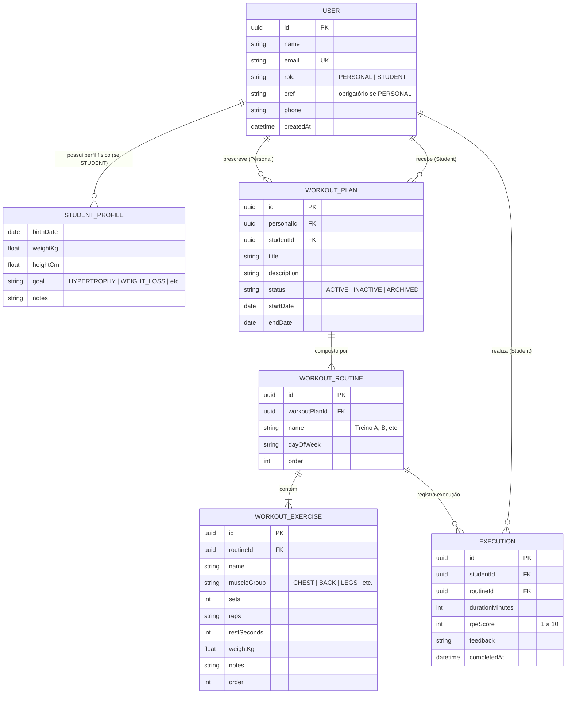

# GymFlow API — Gestão de Treinos e Acompanhamento Físico

> **Projeto Semestral de Arquitetura e Engenharia de Software / APIs REST**  
> **Abordagem:** Design-First no Apidog  
> **Especificação:** OpenAPI 3.1.0 & RFC 9457 (Problem Details)  
> **Ambiente Mock Server:** Cloud Mock Habilitado  

---

## 1. Nome e Propósito da API

### 1.1. Contexto do Problema
No ecossistema de academias e consultorias esportivas, a comunicação e o acompanhamento entre **Personal Trainers** e seus **Alunos** frequentemente sofrem com a falta de padronização, perda de histórico de evolução, prescrição fragmentada (por mensagens de texto ou planilhas estáticas) e ausência de métricas quantitativas de intensidade das sessões de treino.

### 1.2. Propósito e Público-Alvo
A **GymFlow API** é uma solução RESTful de alto nível projetada para:
- **Personal Trainers:** Centralizar a gestão de sua carteira de alunos, parametrizar metas físicas (hipertrofia, emagrecimento, reabilitação), estruturar planos de treino periodizados com rotinas (A, B, C...) e exercícios com prescrição técnica (séries, repetições, descanso e carga sugerida), além de monitorar o engajamento dos alunos.
- **Alunos:** Acessar de forma ágil e estruturada suas fichas de treino atualizadas, consultar detalhes de cada exercício e registrar o check-in pós-treino com duração, percepção subjetiva de esforço (**Escala RPE Borg de 1 a 10**) e feedback qualitativo.

---

## 2. Arquitetura de Recursos e Relacionamentos

A arquitetura da API foi concebida sob o paradigma orientado a recursos (Resource-Oriented Architecture), com separação estrita de responsabilidades e controle de acesso baseado em papéis (RBAC).

### 2.1. Diagrama Entidade-Relacionamento (ER)

### 2.2. Resumo das Entidades de Domínio Modeladas

| Entidade | Papel no Domínio | Operações CRUD Mapeadas |
| :--- | :--- | :--- |
| **Students** *(Entidade 1)* | Gestão dos alunos vinculados à carteira do Personal Trainer e seus perfis biométricos. | `POST /api/v1/students` `GET /api/v1/students` `GET /api/v1/students/{id}` `PATCH /api/v1/students/{id}` `DELETE /api/v1/students/{id}` |
| **Workouts** *(Entidade 2)* | Prescrição de fichas de treino completas, compostas por rotinas (Treinos A/B/C) e exercícios. | `POST /api/v1/workouts` `GET /api/v1/workouts` `GET /api/v1/workouts/{id}` `PATCH /api/v1/workouts/{id}` `DELETE /api/v1/workouts/{id}` |
| **Routines & Exercises** | Sub-recursos de granularidade técnica para montagem progressiva da ficha. | `POST /api/v1/workouts/{id}/routines` `POST /api/v1/routines/{id}/exercises` `DELETE /api/v1/exercises/{id}` |
| **Executions** | Registro de sessões finalizadas pelos alunos com pontuação de esforço RPE (1 a 10) e feedback. | `POST /api/v1/routines/{id}/executions` `GET /api/v1/students/{id}/executions` |
| **Authentication** | Registro seguro, login via JWT e consulta do perfil logado (`/me`). | `POST /api/v1/auth/register` `POST /api/v1/auth/login` `GET /api/v1/auth/me` |

---

## 3. Padrões de Projeto e Requisitos Técnicos no Apidog

1. **Abordagem Design-First & Reusabilidade (Zero Inline Objects):**
   - Todos os corpos de requisição (`Request Bodies`) e respostas (`Responses`) fazem referência estrita (`$ref`) aos modelos definidos na aba **Schemas (Data Schemas)**.
   - Segregação de DTOs de entrada (`CreateStudentDTO`, `UpdateStudentDTO`, `CreateWorkoutPlanDTO`) e de saída (`StudentResponse`, `WorkoutPlanResponse`, `PaginatedStudentsResponse`).
2. **Conformidade Estrita com a RFC 9457 (Problem Details):**
   - Todo erro retornado pela API (HTTP 400, 401, 403, 404, 422) adere ao componente canônico `ApiError`, contendo `type`, `title`, `status`, `detail`, `instance` e lista `invalidParams`.
3. **Nomenclatura no Wire (camelCase):**
   - Todas as propriedades JSON e parâmetros de query utilizam rigorosamente `camelCase` (`personalId`, `studentId`, `workoutPlanId`, `restSeconds`, `rpeScore`, `durationMinutes`, `totalItems`).
4. **Mock Server com Dados Realistas (Mock.js / Faker.js):**
   - Atributos configurados com regras dinâmicas (`@guid`, `@name`, `@email`, `@datetime`, `@float(50, 105, 1, 1)`, etc.) para simulação funcional completa no Cloud Mock do Apidog.

---

## 4. Equipe Envolvida (2 a 4 Integrantes)

> [!IMPORTANT]
> **Atenção:** Preencha os dados dos integrantes do grupo abaixo (obrigatório entre 2 e 4 membros):

| # | Nome Completo | RA / Matrícula | GitHub / E-mail Institucional | Função Principal no Projeto |
| :-: | :--- | :--- | :--- | :--- |
| **1** | *(Nome do Integrante 1)* | *(RA / Matrícula)* | `seu-email@instituicao.edu.br` | Arquiteto de Software & Design da API |
| **2** | *(Nome do Integrante 2)* | *(RA / Matrícula)* | `colega2@instituicao.edu.br` | Modelagem de Schemas & Validações |
| **3** | *(Nome do Integrante 3 - Opcional)* | *(RA / Matrícula)* | `colega3@instituicao.edu.br` | Documentação & Testes do Mock Server |
| **4** | *(Nome do Integrante 4 - Opcional)* | *(RA / Matrícula)* | `colega4@instituicao.edu.br` | Governança REST & Revisão de Contratos |
